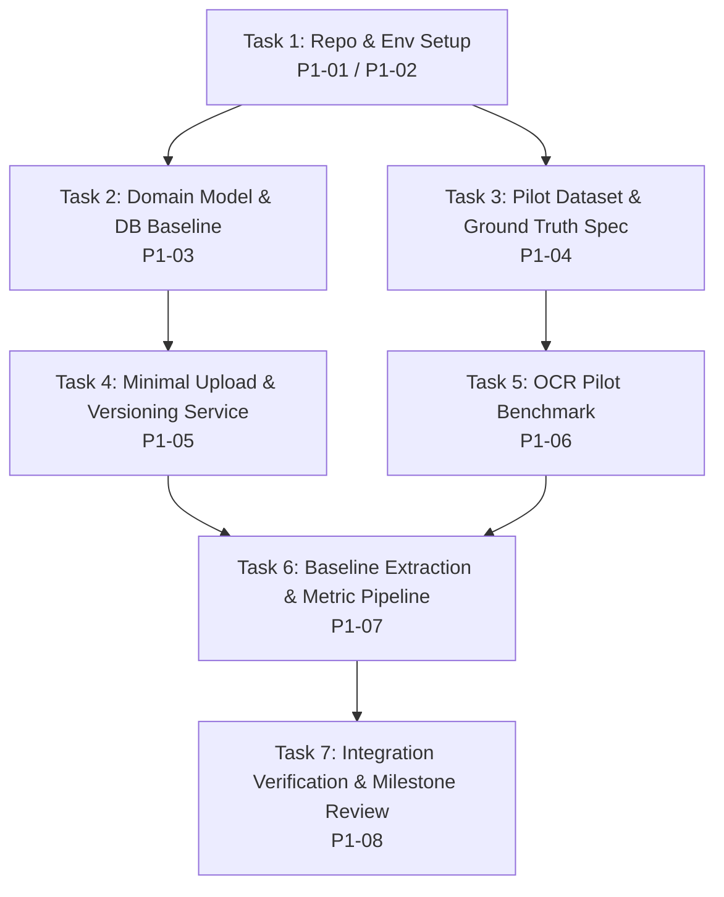

# Phase 1 Implementation Plan: Roadmap to Week 5–6 Milestone

## 1. Objective and Milestone Target

The primary objective of Phase 1 is to establish a verified, testable end-to-end prototype that reaches the **Week 5–6 milestone** defined in [graduation_thesis_master_plan.md](file:///d:/LuanVan/DocumentAI-Thesis-/docs/graduation_thesis_master_plan.md).

### The Week 5–6 Prototype Workflow
1. Create an export shipment entity.
2. Upload a bilingual (English / Vietnamese) Commercial Invoice or Packing List.
3. Store the document in local storage and record an immutable `document_version` with SHA-256 hash and metadata in PostgreSQL.
4. Run ingestion and baseline field extraction (using RapidOCR/Tesseract and rule-based normalization).
5. Persist and expose extracted fields and line items for inspection.
6. Verify the entire workflow with automated integration tests and a reproducible evaluation report against labeled ground truth.

---

## 2. Implementation Dependency Graph

---

## 3. Detailed Task Breakdown

### Task 1 (P1-01 / P1-02) — Repository Scaffolding and Environment Setup
* **Status:** Completed & Verified
* **Dependencies:** None
* **Scope:**
  * Root `.gitignore` for Python, Node, Vite, storage, and secrets.
  * Architecture Decision Records (`ADR-001` through `ADR-004`).
  * Minimal backend dependency configuration (`backend/pyproject.toml`, `backend/requirements.txt`).
  * Verification of PostgreSQL 17, Node 22, npm 10, and Python 3.11 runtime.
  * PowerShell setup guide (`docs/setup_guide.md`).
* **Verification:** Clean `.venv` with Python 3.11.9, dependencies installed, health smoke test passing.

---

### Task 2 (P1-03) — Domain Model and Database Baseline
* **Status:** Completed & Verified
* **Dependencies:** Task 1
* **Scope:**
  * Initialized SQLAlchemy 2.0 declarative models for all 9 core entities:
    `User`, `Party`, `Product`, `Order`, `OrderItem`, `Shipment`, `ShipmentItem`, `Document`, `DocumentVersion`.
  * Preserved `Document` (logical entity) vs `DocumentVersion` (immutable revision with SHA-256 and storage key).
  * Configured Alembic with `backend/alembic.ini` and generated `3c92e448a894_initial_core_entities.py`.
  * Applied migrations to native PostgreSQL 17 database `documentai_thesis`.
  * Verified migration rollback (`downgrade base`) and re-apply (`upgrade head`).
  * Implemented isolated test suite: SQLite unit tests + real PostgreSQL 17 integration tests on `documentai_thesis_test`.
* **Verification:** 11 tests passing (100%), ruff linting clean, `alembic check` clean.

---

### Task 3 (P1-04) — Small Synthetic Bilingual Pilot Dataset & Ground-Truth Specification
* **Status:** Completed & Verified
* **Dependencies:** Task 1
* **Scope:**
  * Defined versioned JSON Schemas for annotations, manifest, and expected cross-document comparisons.
  * Implemented deterministic generator `scripts/generate_pilot_dataset.py` (seed = 42).
  * Generated 12 synthetic packages (24 documents: 12 Commercial Invoices, 12 Packing Lists).
  * Exactly balanced English (6 packages) and Vietnamese (6 packages) with Unicode diacritics.
  * Generated 50 deterministic cross-document comparison rules covering clean cases, QTY, WT, PARTY, MONEY, ID discrepancies, and benign variations.
  * Bounding boxes verified in top-left PDF coordinates `[x_min, y_min, x_max, y_max]` within A4 boundaries.
* **Verification:** `scripts/validate_pilot_dataset.py` passed 100%; `backend/tests/test_dataset_validation.py` passed (7/7 tests).

---

### Task 4 (P1-05) — Minimal Document Upload & Versioning Service
* **Status:** Pending Approval
* **Dependencies:** Task 2 (Domain models & DB ready)
* **Scope:**
  * Implement `StorageService` protocol with `LocalStorageService` saving files to `./storage/uploads/`.
  * Implement document versioning logic:
    * Compute SHA-256 hash upon file upload.
    * Version immutability: uploaded files cannot be modified; a re-upload creates version `N+1`.
    * Enforce file validation (PDF/image MIME types, max file size limit).
  * Implement FastAPI endpoints:
    * `POST /api/shipments` (create shipment)
    * `GET /api/shipments/{id}` (retrieve shipment details)
    * `POST /api/shipments/{id}/documents` (upload document file, create document & version)
    * `GET /api/documents/{id}/versions` (list immutable versions)
* **Acceptance Criteria:**
  * File is safely persisted with UUID-based filename; original filename preserved in database.
  * SHA-256 hash matches uploaded binary.
  * Pytest integration tests assert document version immutability and error handling for invalid files.

---

### Task 5 (P1-06) — OCR Compatibility Check & Pilot Benchmark
* **Status:** Pending Approval
* **Dependencies:** Task 1 (Python 3.11), Task 3 (Pilot dataset)
* **Scope:**
  * Implement PDF ingestion and rendering pipeline using `PyMuPDF` (fitz) or `pypdfium2`.
  * Set up benchmark harness (`scripts/benchmark_ocr.py`) comparing:
    1. Digital text extraction (direct PDF font extraction where available).
    2. RapidOCR (ONNX PP-OCRv4).
    3. Tesseract (if Windows binary is present, with `eng` + `vie` models).
  * Measure metrics: Character Error Rate (CER), word bounding box IoU against ground truth, and inference latency per page (CPU vs GPU).
* **Acceptance Criteria:**
  * Benchmark report generated comparing CER and execution time for English and Vietnamese pilot documents.
  * Selection decision recorded confirming the primary OCR pipeline for Stage 1.

---

### Task 6 (P1-07) — Rule-Based Baseline Extraction and Evaluation
* **Status:** Pending Approval
* **Dependencies:** Task 4 (Upload service), Task 5 (OCR pipeline)
* **Scope:**
  * Implement baseline heuristic/rule extractor for:
    * Commercial Invoice: `invoice_number`, `invoice_date`, `seller_name`, `buyer_name`, `currency`, `total_amount`.
    * Packing List: `packing_list_number`, `issue_date`, `total_packages`, `gross_weight`, `net_weight`.
  * Implement normalization modules for dates (ISO-8601), numbers (decimal/thousand separators), and currency codes.
  * Implement evaluation script comparing extracted values against pilot ground-truth annotations (precision, recall, exact match, tolerance match).
* **Acceptance Criteria:**
  * Baseline extraction runs end-to-end on all 10 pilot documents.
  * Evaluation script outputs exact-match and field-level F1 metrics without manual intervention.

---

### Task 7 (P1-08) — Integration Verification and Milestone Review
* **Status:** Pending Approval
* **Dependencies:** Tasks 2, 4, 6
* **Scope:**
  * End-to-end test combining:
    1. Shipment creation via API.
    2. Upload of synthetic commercial invoice and packing list.
    3. Automatic trigger of OCR and baseline extraction.
    4. Retrieval of extraction candidates via `GET /api/documents/{id}/extractions`.
  * Generate the Phase 1 milestone verification report.
  * Prepare handoff documentation for Phase 2 (Frontend workspace + Pretrained Document AI model).
* **Acceptance Criteria:**
  * Single test script / pytest suite runs the entire flow and passes with 100% assertions.
  * No regressions, no hardcoded credentials, and zero mock/hallucinated test results.

---

## 4. Risk Matrix & Mitigations

| Risk | Impact | Probability | Mitigation Strategy |
| :--- | :--- | :--- | :--- |
| Python 3.11 installation delay | High | Medium | Provided exact `winget` command; minimal dependency files are ready to install immediately once Python 3.11 is added. |
| Vietnamese diacritic OCR degradation | High | Medium | RapidOCR PP-OCRv4 model natively trained on extensive multilingual text; evaluated in Task 5 against ground truth. |
| Incompatible PyTorch builds on RTX 5060 | Medium | High | Rely on ONNX Runtime / RapidOCR for Phase 1 baseline; test PyTorch with CUDA 12.6/12.8 nightly during model research. |
| Database migration conflicts | Low | Low | Alembic configured strictly from day one with linear migration chains and rollback tests. |
